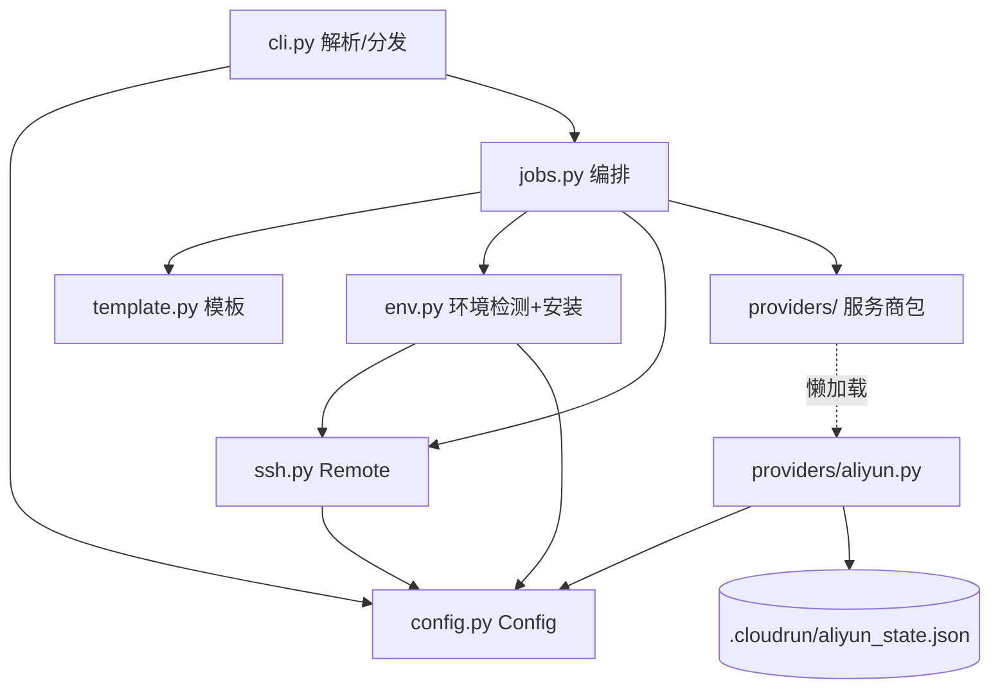
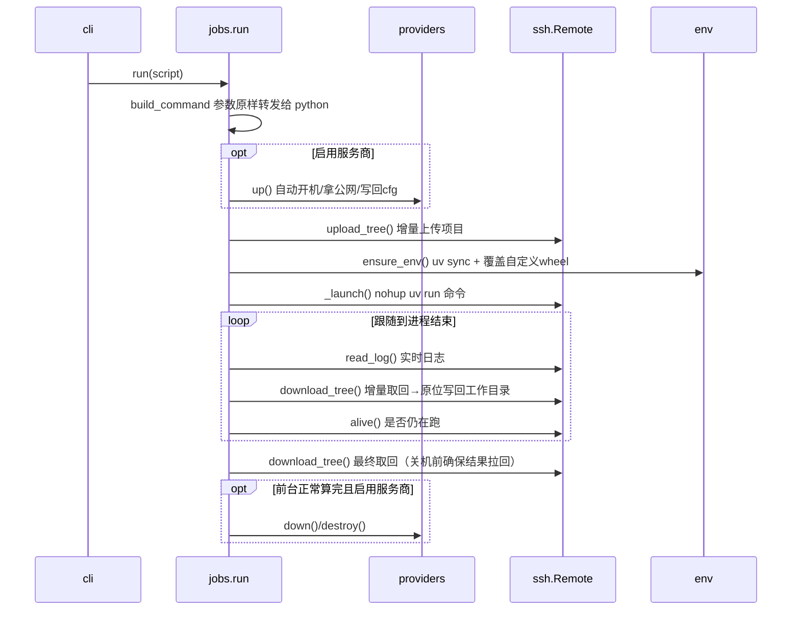

# cloudrun 模块说明（开发者向）

本包实现"本地计算 → 自租云服务器"的提交器。单向分层：CLI 解析分发 → jobs 编排 → 能力模块（环境/传输/服务商）→ paramiko / uv / 阿里云 SDK。

## 模块职责

| 模块 | 职责 | 关键接口 |
|---|---|---|
| `cli.py` | 命令行解析与分发；始终用当前目录 `config.yaml` | `main()` |
| `config.py` | 读取 YAML，展平成 `Config`（含默认值） | `Config.load()` |
| `template.py` | `init` 写出的 `config.yaml` 模板 | `TEMPLATE` |
| `jobs.py` | **编排核心**：参数转发、push、run、日志跟随、结果写回 | `run()`/`build_command()`/`_push`/`_launch`/`_follow` |
| `ssh.py` | 远程会话：SSH 执行、SFTP、**增量上传/下载**、读日志、查存活 | `Remote`（`upload_tree`/`download_tree`/`read_log`/`alive`…） |
| `env.py` | 环境：本地检测模式/依赖 + 远程安装（**uv sync** 或 venv）+ 自定义 wheel 覆盖 | `detect_mode()`/`resolve_requirements()`/`ensure_env()` |
| `providers/` | 云服务商插件包：统一接口，`get_provider()` 按配置懒加载选用 | `get_provider()`；`aliyun.up/down/destroy/apply_state` |
| `__main__.py` | 使 `python -m cloudrun` 可运行 | 转发 `cli.main()` |

## 依赖关系



要点：
- **jobs 是唯一编排者**；能力模块横向依赖只有 `env → ssh`。
- **服务商懒加载**：`get_provider(cfg)` 动态 import；SDK 在模块内函数里才 import，未装某 SDK 不影响基础功能。
- `apply_state()` 把状态里的公网 IP/密钥**写回 `Config`** 供 `ssh` 连接（IP 停机后会变，动态管理）。

## `run` 的完整链路



## 关键设计

- **固定项目目录（无 job 概念）**：远程 `remote_workdir/<工作目录名>` 是本地镜像，增量上传；下次 run 同一目录。
- **命令转发**（`build_command`）：`cloudrun run` 后的参数原样交给 `python`（本地怎么跑远程就怎么跑）；免 `--` 透传由 cli 的 `_prepare_run_argv` 预处理。
- **uv 环境还原**（`env.py`）：远程装 uv，`uv sync` 按 `uv.lock` 装锁定依赖并安装项目（`-m` 直接可用），再 `uv pip install --force-reinstall` 覆盖自定义 wheel；`uv.lock`+wheel 哈希缓存，未变不重装。非 uv 项目回退 venv+requirements。
- **增量同步 + 原位写回（B）**：上传按大小+mtime 跳过；下载用 `snapshot` 跳过未变输入，新/变动文件**写回工作目录原相对路径**；`sync.download_exclude` 排垃圾与内部标记（`.cloudrun_run.*`、`.venv`），**绝不排结果目录**。
- **日志跟随**（`_follow`）：nohup 启动后轮询日志并检查进程存活，进程退出后 `run()` 增量取回文件。Ctrl-C 断开后云端作业继续运行。
- **状态文件**（`providers/aliyun.py`）：实例/网络/密钥 ID 与公网 IP 存 `.cloudrun/aliyun_state.json`，私钥存 `.cloudrun/cloudrun_key.pem`。

## 打包与发布

1. 修改 `pyproject.toml` 的 `[project].version`。

1. 打包与上传：
    ```bash
    uv build      # 打包：生成 dist/cloudrun-0.2.0.tar.gz（源码包）+ dist/cloudrun-0.2.0-py3-none-any.whl（wheel）
    <!-- uv publish    # 上传到 PyPI（需 token：uv publish --token <token>） -->
    ```

## 新增云服务商

1. `providers/` 加模块（如 `tencent.py`），实现 `is_enabled/reuse/up/down/destroy/apply_state`，配置读 `cfg.provider.get("tencent", {})`。
2. `providers/__init__.py` 的 `PROVIDERS` 登记名字。
3. 模板/示例配置加 `provider.tencent` 段。

`config.py`、jobs、cli 均无需改动（`provider` 是通用字典）。
